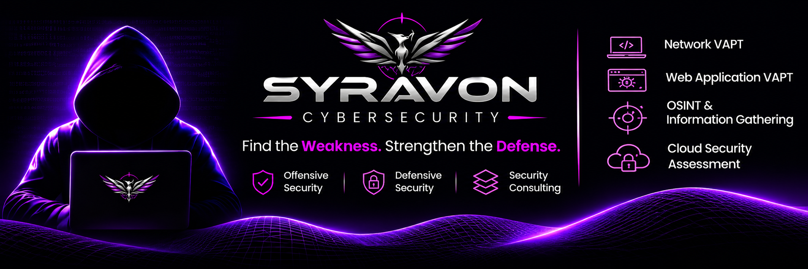

# 🛡️ SYRAVON OSINT Toolkit

<p align="center">
  
</p>

<p align="center">
  **A Python-based OSINT toolkit for authorized defensive research**
</p>

<p align="center">
  <a href="https://syravon-osint.onrender.com/"><strong>🚀 Open Live Web Application</strong></a>
</p>


<p align="center">
  <a href="https://www.python.org/">
    
  </a>
  <a href="https://flask.palletsprojects.com/">
    
  </a>
  <a href="LICENSE">
    
  </a>
  <a href="https://github.com/syravon/syravon-osint">
    
  </a>
</p>


---

## 🌐 Live Web Application

**Live URL:** https://syravon-osint.onrender.com/

SYRAVON OSINT is deployed on Render and provides a browser-based interface for its OSINT modules.

**Access note:** The hosted application is protected by HTTP Basic Authentication. Login credentials are provided separately by the project operator and are not published in this repository.

> Note: The Render free instance may sleep after inactivity. The first request may take some time to respond.

---

## 📖 About the Project

**SYRAVON OSINT** is a Python-based Open Source Intelligence toolkit designed for educational, defensive, and authorized security research.

It provides selected public technical information about domains and IP addresses, checks domain-level email security records, and inspects metadata in user-provided images.

The project includes:
- Command-Line Interface (CLI)
- Flask-based Web Interface
- Structured JSON output
- JSON report download from the web interface
- Authentication and rate limiting for the hosted web application

This toolkit is not a full vulnerability scanner, mailbox verifier, or user-attribution tool.

---

## ✨ Features

### 🌍 1. Domain Reconnaissance
- DNS A, AAAA, MX, and TXT record lookups
- TLS certificate information
- HTTPS response status
- Selected HTTP security headers:
  - HSTS
  - Content-Security-Policy
  - X-Frame-Options
  - X-Content-Type-Options
  - Referrer-Policy
- Basic security-header presence summary

### 🌐 2. IP Intelligence
- IPv4 and IPv6 address validation
- Public/private address classification
- Loopback, multicast, and reserved address indicators
- Reverse DNS lookup for globally routable IP addresses
- RDAP network allocation information when available

### 📧 3. Email Domain Security
- MX record inspection
- SPF record lookup
- DMARC record lookup

These checks inspect domain-level DNS configuration. They do not verify whether a mailbox exists or identify its owner.

### 🖼️ 4. Image Metadata Analysis
- Image format
- Image dimensions
- Color mode
- Available EXIF metadata

Supported image formats in the web upload:
- JPG / JPEG
- PNG
- TIFF
- WEBP

Maximum image upload size: **20 MB**.

### 📄 5. JSON Reports
- Structured JSON output from CLI commands
- JSON report download from the web interface
- Timestamped scan results

---

## 🖥️ Command-Line Usage

### Available Commands

```bash
python -m syravon_osint domain example.com
```

```bash
python -m syravon_osint ip 8.8.8.8
```

```bash
python -m syravon_osint email-domain example.com
```

```bash
python -m syravon_osint metadata ./photo.jpg
```

### Save a JSON Report

Add `--json` followed by the output filename:

```bash
python -m syravon_osint domain example.com --json report.json
```

---

## ⚙️ Installation

### Requirements
- Python
- Git
- Internet connection for network-based lookups

### Step 1: Clone the Repository

```bash
git clone https://github.com/syravon/syravon-osint.git
```

```bash
cd syravon-osint
```

### Step 2: Create a Virtual Environment

**Windows PowerShell:**

```powershell
python -m venv .venv
.venv\Scripts\Activate.ps1
```

**Linux / Kali Linux:**

```bash
python3 -m venv .venv
source .venv/bin/activate
```

### Step 3: Install Dependencies

```bash
python -m pip install --upgrade pip
pip install -r requirements.txt
```

---

## 🚀 Run the Web Application Locally

From the project root directory:

```bash
python -m syravon_osint.web
```

Open your browser:

```text
http://127.0.0.1:5000
```

For a Gunicorn run:

```bash
gunicorn syravon_osint.web:app
```

---

## 🔐 Web Application Security

The Flask web application includes:

- HTTP Basic Authentication
- Constant-time credential comparison
- Flask-Limiter request rate limiting
- Default application limit: 100 requests per hour
- Scan endpoint limit: 10 requests per minute
- Maximum image upload size: 20 MB
- Secure session cookie settings

### Environment Variables

Configure the following variables in your deployment environment:

| Variable | Purpose |
|---|---|
| `SECRET_KEY` | Flask secret key |
| `SYRAVON_USERNAME` | Web application username |
| `SYRAVON_PASSWORD` | Web application password |
| `RATELIMIT_STORAGE_URI` | Rate-limit storage backend URI |

For production deployments, configure a reachable Redis service using `RATELIMIT_STORAGE_URI` so rate-limit data can be shared and persisted.

**Never publish passwords, secret keys, or Redis connection URLs in source code, screenshots, or README files.**

---

## 📁 Project Structure

```text
syravon-osint/
│
├── .github/
├── syravon_osint/
│   ├── templates/
│   ├── __init__.py
│   ├── __main__.py
│   ├── core.py
│   └── web.py
│
├── tests/
├── .gitignore
├── LICENSE
├── README.md
├── requirements.txt
├── run-web.sh
└── syravon-logo.png
```

---

## ☁️ Deployment

The hosted web application runs on **Render** using Flask and Gunicorn.

- **GitHub Repository:** https://github.com/syravon/syravon-osint
- **Live Application:** https://syravon-osint.onrender.com/

The deployed application requires valid authentication credentials.

---

## ⚠️ Responsible Use & Disclaimer

SYRAVON OSINT is intended only for:
- Authorized security testing
- Educational purposes
- Defensive cybersecurity research
- Analysis of systems and files you own or have permission to inspect

Do not use this toolkit for unauthorized reconnaissance, privacy violations, or illegal activities.

Public DNS, RDAP, and network information may be incomplete or unavailable. Results are informational and should be independently verified.

Image metadata may contain sensitive information. Review reports before sharing them.

The developer is not responsible for misuse or damage resulting from unauthorized use of this software.

---

## 📄 License

This project is licensed under the **MIT License**.

See the [LICENSE](LICENSE) file for details.

---

## 👨‍💻 Developer

**SYRAVON Cybersecurity**

- GitHub: https://github.com/syravon
- Project Repository: https://github.com/syravon/syravon-osint
- Live Web Application: https://syravon-osint.onrender.com/

<p align="center">
  **SYRAVON OSINT — Intelligence. Security. Awareness.**
</p>

<p align="center">
  Made with ❤️ by SYRAVON Cybersecurity
</p>
